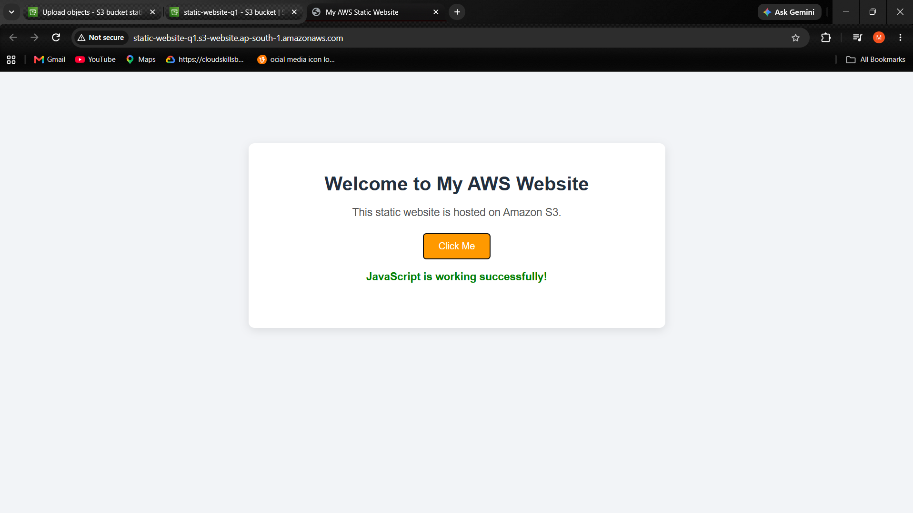
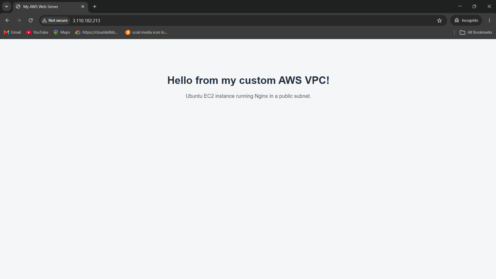
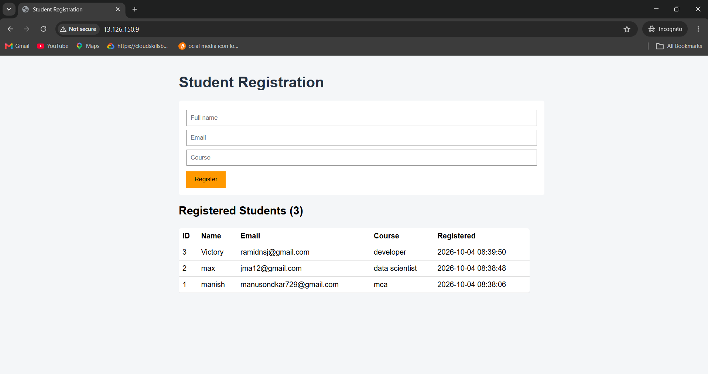
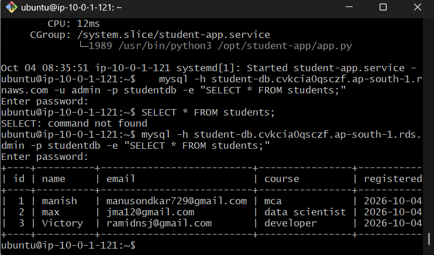

# AWS Cloud Assignment

Hands-on AWS labs covering static hosting, networking, compute, and managed databases. All resources were created in **Asia Pacific (Mumbai) - ap-south-1** and deleted after the demo to avoid charges.

## Contents
1. [Q1: Static Website on Amazon S3](#q1-static-website-on-amazon-s3)
2. [Q2: Custom VPC with Ubuntu EC2 and Nginx](#q2-custom-vpc-with-ubuntu-ec2-and-nginx)
3. [Q3: Student Registration App on EC2 + RDS MySQL](#q3-student-registration-app-on-ec2--rds-mysql)

> No private keys (`.pem`) or real passwords are included in this document or repo.

---

# Q1: Static Website on Amazon S3

## Objective
Design and deploy a static website on AWS using Amazon S3. Configure the bucket for static website hosting, upload HTML/CSS/JavaScript files, configure the required permissions, and demonstrate the working website URL.

## Architecture
```
Browser --HTTP--> S3 static website endpoint --> Bucket
                                                 ├── index.html
                                                 ├── style.css
                                                 ├── script.js
                                                 └── error.html
```
Public read access is granted by a bucket policy (`s3:GetObject`).

## Files
| File | Purpose |
|------|---------|
| `site/index.html` | Home page with a button |
| `site/style.css` | Styling |
| `site/script.js` | Button shows the current time (proves JavaScript runs) |
| `site/error.html` | Custom error page |
| `bucket-policy.json` | Public-read policy (replace `YOUR-BUCKET-NAME`) |

## Steps performed
1. **Create the bucket** - S3 → Create bucket, globally unique name, region Mumbai.
2. **Allow public access** - untick *Block all public access* and accept the warning.
3. **Upload files** - upload everything inside `site/`.
4. **Enable static website hosting** - Properties → Static website hosting → Enable; index document `index.html`, error document `error.html`.
5. **Add bucket policy** - Permissions → Bucket policy → paste `bucket-policy.json` with the real bucket name.
6. **Test** - open the *Bucket website endpoint* in a browser and click the button.

## Bucket policy
```json
{
  "Version": "2012-10-17",
  "Statement": [
    {
      "Sid": "PublicReadGetObject",
      "Effect": "Allow",
      "Principal": "*",
      "Action": "s3:GetObject",
      "Resource": "arn:aws:s3:::YOUR-BUCKET-NAME/*"
    }
  ]
}
```

## Output
| Screenshot | 
|-----------|

 
 | Working website with URL visible |

## Troubleshooting
- **403 Forbidden** - policy missing, wrong bucket name, or Block Public Access still on.
- **404 Not Found** - index document name does not match the uploaded file.

## Result
The website loads from the S3 website endpoint (`http://<bucket>.s3-website.ap-south-1.amazonaws.com`) and the JavaScript button works. The bucket was emptied and deleted afterwards.

---

# Q2: Custom VPC with Ubuntu EC2 and Nginx

## Objective
Create a custom AWS VPC with one public subnet and deploy an Ubuntu EC2 instance. Configure an Internet Gateway, route table, and Security Group, install Nginx, and host a basic HTML page accessible through the public IP.

## Architecture
```
Internet
   │
Internet Gateway (my-web-IGW)
   │
Public-Route-Table:  10.0.0.0/16 → local
                     0.0.0.0/0   → my-web-IGW
   │
my-web-vpc (10.0.0.0/16)
   └── Public-Subnet (10.0.1.0/24)
          └── EC2 Ubuntu (Nginx) + web-sg (SSH from my IP, HTTP from anywhere)
```

## Resources
| Resource | Value |
|----------|-------|
| VPC | `my-web-vpc` - 10.0.0.0/16 |
| Subnet | `Public-Subnet` - 10.0.1.0/24, auto-assign public IPv4 on |
| Internet Gateway | `my-web-IGW` - attached to `my-web-vpc` |
| Route table | `Public-Route-Table` - `0.0.0.0/0 → IGW`, associated with `Public-Subnet` |
| Security group | SSH (22) from my IP, HTTP (80) from `0.0.0.0/0` |
| Instance | `Ubuntu-Web-Server`, Ubuntu 26.04, key pair for SSH |

## Steps performed
1. Create the VPC `my-web-vpc` (10.0.0.0/16).
2. Create `Public-Subnet` (10.0.1.0/24) and enable auto-assign public IPv4.
3. Create and attach the Internet Gateway.
4. Create `Public-Route-Table`, add `0.0.0.0/0 → IGW`, and associate it with `Public-Subnet`.
5. Create the security group (SSH from my IP, HTTP from anywhere).
6. Launch the Ubuntu EC2 instance in `Public-Subnet` with a public IP.
7. SSH in, install Nginx, and deploy `index.html`.
8. Open `http://<public-ip>` in a browser.

## Commands used
```bash
ssh -i <key>.pem ubuntu@<public-ip>

sudo apt update
sudo apt install -y nginx
sudo systemctl enable --now nginx
systemctl status nginx

sudo cp index.html /var/www/html/index.html
curl http://localhost
```
`setup.sh` in this folder runs the install steps in one go.

## Output
| Screenshot |
|-----------|

 

## Troubleshooting notes
- **SSH timed out** - the security group did not allow port 22 from my current IP; fixed by updating the rule.
- **`Permission denied (publickey)`** - the `.pem` file did not match the key pair in AWS. Fixed by comparing fingerprints with `openssl pkcs8 -in key.pem -nocrypt -topk8 -outform DER | openssl sha1 -c`.
- **Host key changed warning** - the public IP changed after a stop/start; connecting to the new IP fixed it.

## Result
The page "Hello from my custom AWS VPC!" loads at `http://<public-ip>`, served by Nginx from the public subnet. Resources were deleted after the demo.

---

# Q3: Student Registration App on EC2 + RDS MySQL

## Objective
Deploy a student registration application using Amazon EC2 and Amazon RDS. Configure the EC2 web server and an RDS MySQL database, establish secure connectivity between them, store student records in the database, and demonstrate successful data insertion and retrieval.

## Architecture
```
Browser ──HTTP 80──> EC2 (Flask app, Public-Subnet)
                          │  MySQL 3306, only from web-sg
                          ▼
                   RDS MySQL (private subnets, not publicly accessible)
```

## Resources
| Resource | Value |
|----------|-------|
| VPC | `my-web-vpc` (10.0.0.0/16), reused from Q2 |
| Public subnet | `Public-Subnet` 10.0.1.0/24 (web server) |
| Private subnets | `Private-Subnet-1` 10.0.2.0/24, `Private-Subnet-2` 10.0.3.0/24 (different AZs) |
| Private route table | main route table, `local` route only (no IGW route) |
| DB security group | `db-sg`: MySQL/Aurora 3306, source = web server security group |
| DB subnet group | `student-db-subnet-group` (both private subnets) |
| Database | `student-db`, MySQL 8.4, `db.t3.micro`, initial DB `studentdb`, **Public access: No** |

## Files
| File | Purpose |
|------|---------|
| `app/app.py` | Flask app: registration form, insert and list students |
| `student-app.service` | systemd unit so the app runs at boot |
| `student-app.env.example` | Template for DB credentials (real file is never committed) |

## Steps performed
1. Create two private subnets in two Availability Zones.
2. Create `db-sg` allowing 3306 only from the web security group.
3. Create the DB subnet group with the private subnets.
4. Create the RDS MySQL instance (Full configuration, public access No, security group `db-sg`, initial database `studentdb`).
5. SSH into EC2 and install dependencies.
6. Test the connection from EC2 to RDS with the `mysql` client.
7. Store credentials in `/etc/student-app.env` (`chmod 600`).
8. Deploy `app.py` and start it as a systemd service.
9. Register students in the browser and verify rows in the database.

## Commands used
```bash
# On EC2
sudo systemctl disable --now nginx        # free port 80 (from Q2)
sudo apt update
sudo apt install -y mysql-client python3-flask python3-pymysql

# Connectivity test
mysql -h <rds-endpoint> -u admin -p studentdb

# Credentials (copy from student-app.env.example, fill in real values)
sudo nano /etc/student-app.env
sudo chmod 600 /etc/student-app.env

# Deploy app
sudo mkdir -p /opt/student-app
sudo cp app/app.py /opt/student-app/app.py
sudo cp student-app.service /etc/systemd/system/student-app.service
sudo systemctl daemon-reload
sudo systemctl enable --now student-app
systemctl status student-app

# Verify data directly in RDS
mysql -h <rds-endpoint> -u admin -p studentdb -e "SELECT * FROM students;"
```

## Output
| Screenshot | 
|-----------|

  Registration form with students listed 

  `SELECT * FROM students;` result 

## Troubleshooting notes
- **Free plan instance limit error** when creating the DB - removed an older RDS instance from a previous lab.
- **`SELECT: command not found`** - SQL was typed at the Ubuntu prompt; run it inside `mysql>` or with `mysql ... -e "..."`.
- **App fails to start** - check `sudo journalctl -u student-app -n 30`; port 80 in use means Nginx is still running.

## Security
- The database is in private subnets with no public access.
- Only the web server's security group can reach port 3306.
- Credentials are read from an environment file with `600` permissions, never hard-coded or committed.

## Result
Students registered through the web form appear in the page table and in the `students` table in RDS, confirming successful insertion and retrieval. The RDS instance, EC2 instance, and VPC were deleted after the demo.
